# VPO - TP1

# Partie 1 - Présentation de la structure de données Image

Après portage du programme python vers du C++, nous obtenons le code suivant:

```c++
Mat img_gray = imread("../imagesDeTest/monarch.png", IMREAD_GRAYSCALE);
std::cout << "Taille (gris) : " << img_gray.shape() << ", Cannaux: " << img_gray.channels() << ", Type : " << img_gray.type() << std::endl;

Mat img_color = imread("../imagesDeTest/monarch.png", IMREAD_COLOR);
std::cout << "Taille (couleur) : " << img_color.shape() << ", Cannaux: " << img_color.channels() << ", Type : " << img_color.type() << std::endl;

Mat img_rgba = imread("../imagesDeTest/po.png", IMREAD_UNCHANGED);
std::cout << "Taille (RGBA) : " << img_rgba.shape() << ", Cannaux: " << img_rgba.channels() << ", Type : " << img_rgba.type() << std::endl;

//Lire la valeur d'un pixel
Vec4b &color = img_rgba.at<Vec4b>(0, 0);
std::cout << "B: " << (int)color[0] << ", G: " << (int)color[1] << ", R: " << (int)color[2] << ", A: " << (int)color[3] << std::endl;
```

En C++, la fonction shape ne renvoie pas le nombre de cannaux.
L'affichage a donc été adapté afin de rajouter cette information manquante.

Similairement, la fonction `dtype` est nommée `type` en C++ et retourne un entier. 
Du code existe pour reconvertir ces entiers en chaines de caractères (voir [ce lien](https://gist.github.com/rummanwaqar/cdaddd5a175f617c0b107d353fd33695))

# Partie 2 - Histogramme

## Utilisation de l'IA

matplotlib n'étant pas disponible, l'IA a été utilisée afin de générer le code permettant de tracer l'histogramme.

## Calcul et affichage de l'histogramme

Nous obtenons le résultat suivant:

| Image | Histogramme |
|-------|-------------|
| 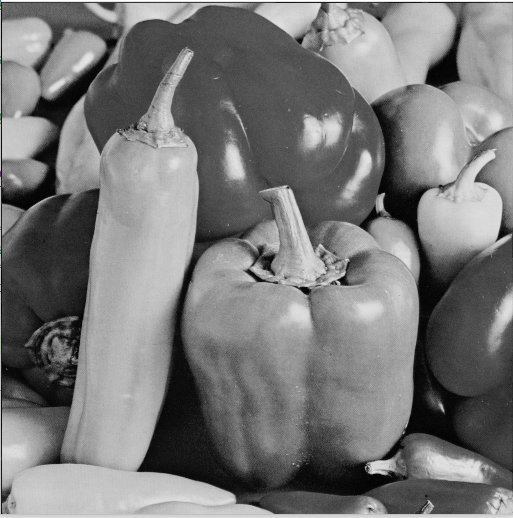 | 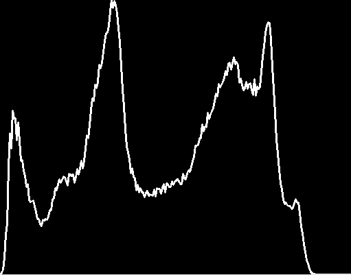 |

On peut constater un manque de valeur les plus élevées dans l'histogramme (abscence de blanc).

## Egalisation de l'histogramme

Après égalisation de l'histogramme nous obtenons les résultats suivant:

| Image | Histogramme |
|-------|-------------|
| 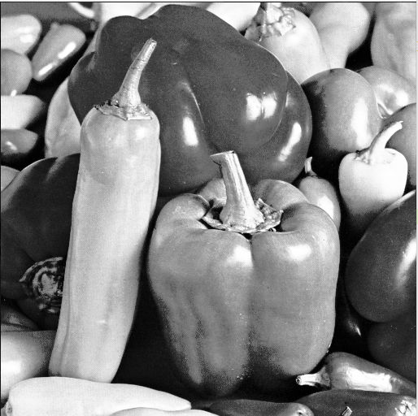 | 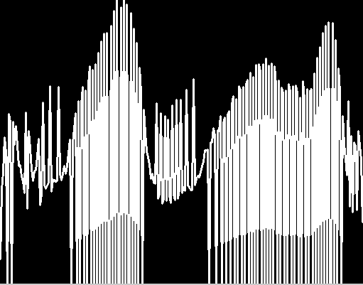 |

On peut constater que le contraste est amélioré, toutes les parties de l'histogramme sont maintenant utilisées.

## Modification de la luminosité et du contraste

| Image originale | Alpha = 1 Beta = 40 | Alpha = 1,5 Beta = 0 |
|-----------------|---------------------|----------------------|
|  |  |  |

Visuellement, nous pouvons constater que l'augmentation du beta permet d'augmenter la luminosité et que l'augmentation d'alpha permet d'améliorer le contraste. 

Si on regarde les histogrammes :

| Image originale | Alpha = 1 Beta = 40 | Alpha = 1,5 Beta = 0 |
|-----------------|---------------------|----------------------|
| 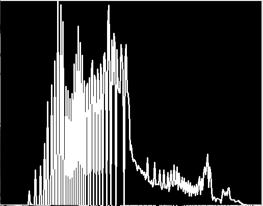 | 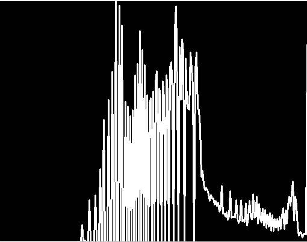 | 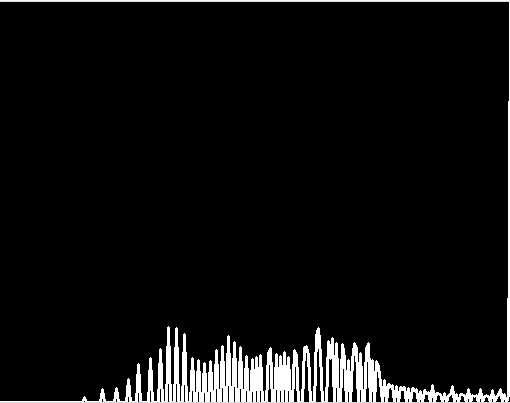 |

On constate que l'augementation de beta décale l'histogramme vers la droite, augmentant ainsi la quantité de blanc dans l'image.

L'augmentation d'alpha permet d'augmenter l'espacement entre les pics, augmentant ainsi le contraste.

L'augmentation du contraste permet de rendre l'image plus lisible. Alpha est donc un paramètre important.

# Partie 3 - Redimensionnement de l'image

## Sous-Echantillonage

Voici la fonction créée pour redimensionner l'image: 

```cpp
void sous_echantillonner(Mat &img, int factor)
{
    Mat outImg(img.rows / factor, img.cols / factor, img.type());

    int r, g, colorMean;
    for (int i = 0; i < img.rows; i += factor)
    {
        for (int j = 0; j < img.cols; j += factor)
        {
            colorMean = 0;
            for (int x = 0; x < factor; x++)
            {
                for (int y = 0; y < factor; y++)
                {
                    colorMean += img.at<uchar>(i + x, j + y);
                }
            }
            colorMean /= factor * factor;
            outImg.at<uchar>(i / factor, j / factor) = colorMean;
        }
    }
    std::cout << "Taille image d'origine " << img.shape() << std::endl;
    std::cout << "Taille image redimentionnée" << outImg.shape() << std::endl;
    imshow("Image d'origine", img);
    imshow("Image redimentionnée", outImg);
}
```

On obtient en sortie: 
```
Taille image d'origine [256 x 256]
Taille image redimentionnée[64 x 64]
```

Et l'image suivante:

| Image originale | Image redimentionnée |
|-----------------|---------------------|
| 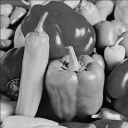 | 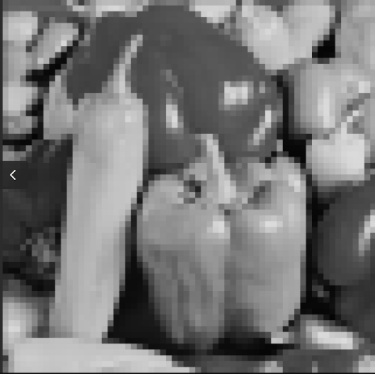 |

En utilisant la fonction `resize` nous obtenons les images suivantes:

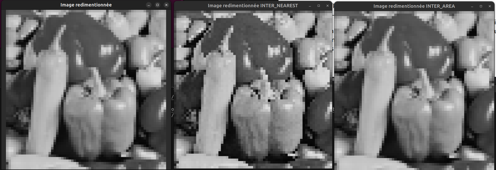

On peut constater que la méthode INTER_NEAREST permet de donner une image très nette au prix de certains détails.
La méthode INTER_AREA permet de donner une image moins "nette" mais ressemble plus à l'image d'origine.

## Sur-Echantillonage

Lors du sur-échantillonage avec la fonction `resize` nous obtenons les images suivantes:

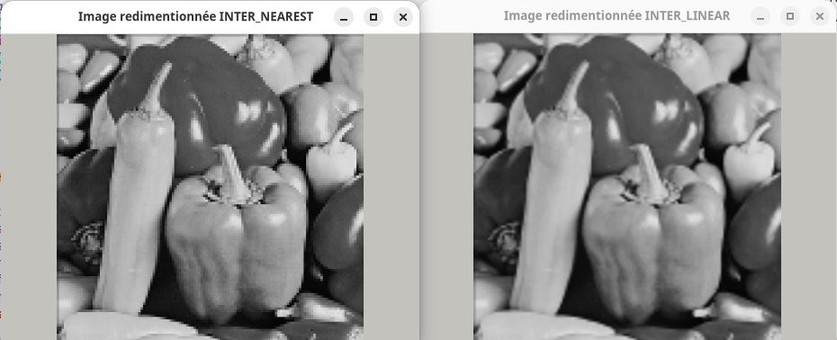

On constate que l'image sur-échantillonée avec la méthode "NEAREST" apparait plus nette, mais les pixels dessinant les contours sont très visibles.

L'image utilisant la méthode "LINEAR" apparait plus "floue", les contours sont moins marqués.

L'agrandissement ne permet cependant pas de retrouver tous les détails de l'image originale (512*512).

Par exemple, en prenant un détail de l'image originale: 

| Image originale | Image redimentionnée |
|-----------------|---------------------|
| 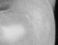 | 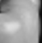 |

On ne retrouve pas la "tache" sur l'image sur-échantillonée.

L'opération de redimmensionnement provoque une perte d'information.

# Partie 4 - Quantification, LUT et plan de couleur

## Quantification de niveaux de gris

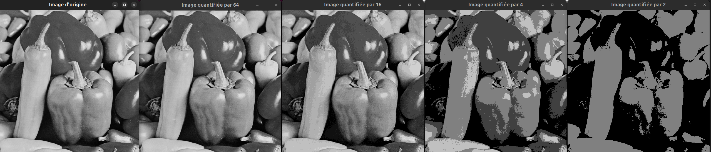

On constate un réel changment seulement à partir des la quantification par 16 de notre image. On peut observer que certaines couleurs se fonssent tandi que d'autre s'éclairessissent. On observe également que plus la quantification est basse (N plus petit), plus les couleurs s'unifient et les ombres et reflets se distingues. Les détails se perdent avec la réduction du facteur de quantification N. C'est à partir de la quantification par 4 que l'on distingue nettement les régions. 

Sur les histogrames, il est possible d'observer clairement le facteur de quantification. Pour la quantification par 64, on distingue 64 piques à égale distance. De même pour les autres facteurs. 

## Application de LUT colorées

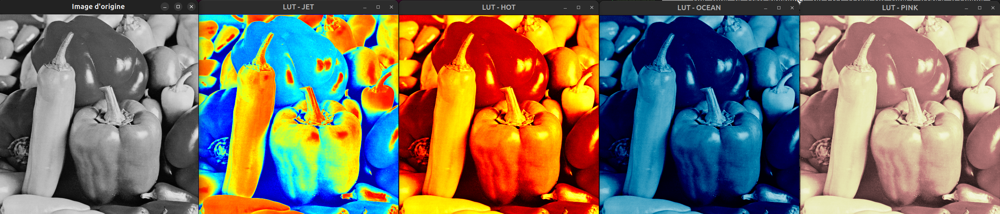

Bien que les LUT modifient grandement la représentation de l'image, elles n'ajoutent pas d'informations à l'image originale. La seule information (par pixel) représentée dans l'image originale est le niveau de gris, les LUT "remplacent" (représentent) cette information par un niveau de couleur (rouge, bleu, rose) ou par un dégradé de couleur (JET). Mais dans tous les cas, une seule information est stockée par pixel et ne change pas, c'est une valeur de 0 à 255.

Pour la comparaison des intensités des pixels de l'image, la LUT avec le dégradé de couleur (JET) semble être la meilleure représentation. Il est plus aisé de distinguer les faibles et fortes intensités par des couleurs différentes. 

## Séparation des plans de couleur

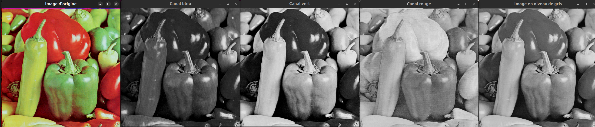

Sur cette image, on observe que la couleur bleu n'a pas beaucoup d'impact par rapport aux autres couleur (rouge et vert). À contrario, la couleur rouge semble être plus importante/intense. 

D'après l'équation, la couleur verte est la plus impactante dans la luminosité de l'image et la couleur bleu est la moins impactante. 

On peut observer une différence entre le niveau de gris et le plan vert sur les légumes rouges de l'image. Ces zones sont éclairessies sur le niveau de gris. Cela n'est pas dû à la composante verte ce qui explique l'écart. La composante rouge est très intense sur les zones rouges de l'image (ce qui est logique) et donc éclairessit ces zones sur le niveau de gris.

# Partie 5 - Rotation

Pour effectuer une rotation, on calcule d'abord le centre de l'image puis la matrice de rotation avec le code suivant:

```cpp
Mat squares = imread("../imagesDeTest/squares.tif");

int height = squares.rows;
int width = squares.cols;

Point2f center(width / 2.0f, height / 2.0f);
Mat rotation_90 = getRotationMatrix2D(center, -90, 1.0);
Mat rotation_45 = getRotationMatrix2D(center, -45, 1.0);
Mat rotation_15 = getRotationMatrix2D(center, -15, 1.0);
```

Ensuite on utilise la fonction `warpAffine` : 

```cpp
Mat rotated_90_image;
warpAffine(squares, rotated_90_image, rotation_90, cv::Size(width, height), INTER_LINEAR);
```

Avec le mode d'interpolation "NEAREST" nous obtenons les images suivantes: 

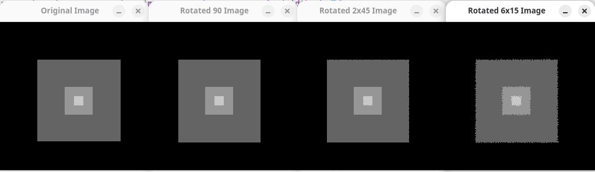

Bien que les rotations soient toutes au final de 90° on constate que les images sont différentes.
L'image qui effectue directement la rotation de 90° ne subit aucune dégradation de qualité.

Les images tournées en plusieurs fois montrent une dégradation en qualité.
Cela s'explique par le fait qu'une rotation de 45° ou 15° fait que certain pixels se retrouvent "en dehors de la grille". Une interpolation est alors nécessaire.

Le cumul de ces interpolations provoquent la perte en qualité observée.
Pour le mode "NEAREST" on constate que les bords sont dégradés (effet "d'érosion").

Voici les images obtenues avec le mode "LINEAR" :

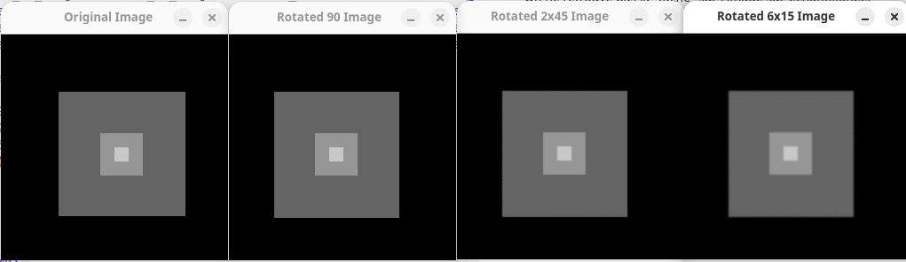

On peut constater ici aussi que les images qui subissent plus de rotations sont dégradées.
Dans ce mode, les dégradations sont visibles sous forme de "flou" au niveau des bordures.

# Partie 6 - Convolution et filtrage d'images bruitées

## Application de filtres de convolution

On code une fonction `convolution` pour appliquer un filtre: 
```cpp
Mat convolution(const Mat &img, const Mat &kernel, const std::string &title)
{
    Mat resultat;

    filter2D(img, resultat, CV_32F, kernel);

    Mat affichage;
    normalize(resultat, affichage, 0, 255, NORM_MINMAX, CV_8U);

    namedWindow(title, WINDOW_NORMAL);
    imshow(title, affichage);

    return resultat;
}
```

Le calcul est réalisé en `CV_32F` afin de conserver les valeurs négatives produites par certains filtres. Pour l'affichage, le résultat est normalisé entre 0 et 255.
On déclare comme suit les kernels :
```cpp
Mat K1 = (Mat_<float>(3, 3) <<
        1, 2, 1,
        2, 4, 2,
        1, 2, 1
    ) / 16.0f;
```

On obtient les résultats suivants :
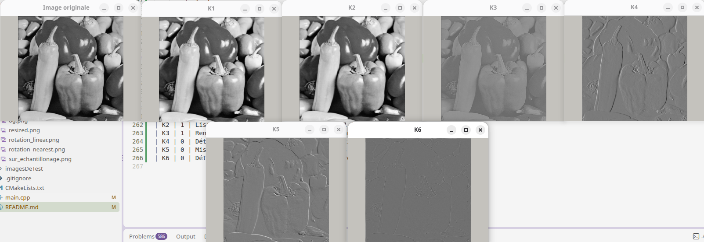

| Noyau | Somme des coefficients | Effet |
|-------|------------------------|-------------|
| K1 | 1 | Lissage |
| K2 | 1 | Lissage |
| K3 | 1 | Renforcement des détails |
| K4 | 0 | Détection de contours principalement verticaux |
| K5 | 0 | Mise en évidence de variations diagonales |
| K6 | 0 | Détection des contours dans plusieurs directions |

Les kernels K1 et K2 lissent l'image, le kernel K3 renforce les détails et les kernels K4 K5 et K6 permettent la détection de contours.

Quand la somme des coefficients vaut 1, l'image est conservée. Quand elle vaut 0 on vient extraire des informations de l'image.

Le noyau K2 donne un lissage plus uniforme. Ceci est cohérent avec la répartitions des coefficients (ceux de K2 sont les mêmes partout là où ceux de K1 sont différents )

Le noyau K4 détecte les contours verticaux, K5 et K6 les contours dans toutes les directions.

Afin de permettre l'affichage des images après des opérations avec des flottants. Nous avons normalisé l'images en valeurs entre 0 et 255.

Un calcul avec des nombres non signés induirait une perte d'information pour les kernels utilisant des nombres négatifs.